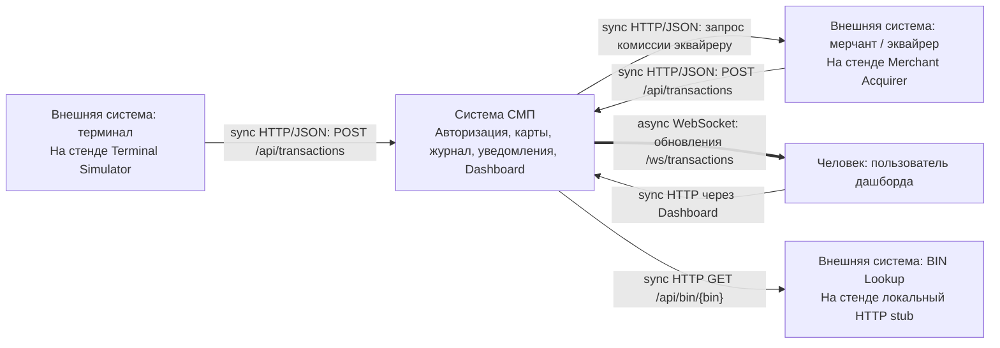

# А1. C4 Level 1 — Context

| Элемент / связь | Ссылка на классы                                                                                                                                                                                                                                                                                                                            |
|---|---------------------------------------------------------------------------------------------------------------------------------------------------------------------------------------------------------------------------------------------------------------------------------------------------------------------------------------------|
| Терминал → СМП | [GatewayClient.java](../../../services/terminal-simulator/src/main/java/com/processing/terminalsimulator/client/GatewayClient.java): HTTP POST `/api/transactions`, HTTP GET `/api/cards`                                                                                                                                                   |
| Мерчант → СМП | [GatewayClient.java](../../../services/merchant-acquirer/src/main/java/com/processing/merchantacquirer/client/GatewayClient.java): `processAuthorize()`, HTTP POST `/api/transactions`, HTTP GET `/api/cards`                                                                                                                               |
| СМП → эквайрер | [MerchantAcquirerClient.java](../../../services/switch/src/main/java/com/processing/service/MerchantAcquirerClient.java): HTTP POST `/api/simulator/merchant/fee`                                                                                                                                                                           |
| Пользователь → Dashboard → API; обратный WebSocket | [nginx.conf](../../../services/dashboard/nginx.conf): HTTP proxy `/api/` и WebSocket upgrade `/ws/`; [WebSocketConfig.java](../../../services/transaction-logger/src/main/java/com/processing/transactionlogger/websocket/WebSocketConfig.java): регистрация endpoint                                                                           |
| СМП → внешний BIN | [BinLookupClient.java](../../../services/authorization/src/main/java/com/processing/authorization/client/BinLookupClient.java): `getIssuerId()`; [BinLookupController.java](../../../services/bin-lookup/src/main/java/com/processing/binlookup/controller/BinLookupController.java): локальная статическая таблица для эмуляции внешнего API `/api/bin`|