# А2. C4 Level 2 — Container

**Чего не хватало:** проверенной по Compose инвентаризации, типов связей, обоих AMQP-путей и доступа Merchant Acquirer к БД.

**Что добавлено:** десять прикладных контейнеров, опциональный одиннадцатый autoscaler, PostgreSQL, RabbitMQ и вспомогательный контур observability.

**Уточнение числа 11:** в [docker-compose.yaml](../../../docker-compose.yaml) ровно десять прикладных сервисов. Autoscaler — одиннадцатый только при включении профиля observability; это shell-инструмент, а не Java-микросервис. Prometheus, Grafana, Loki, Promtail — ещё четыре инфраструктурных контейнера того же профиля. Итого базовый стенд: 12 контейнеров с БД и брокером; с observability: 17. Несуществующий одиннадцатый бизнес-сервис не добавлен.

```mermaid
flowchart TB
    subgraph STAND["Docker-стенд СМП"]
        T["1. terminal-simulator<br/>Java / Spring Boot :8080"]
        M["2. merchant-acquirer<br/>Java / Spring Boot :8080"]
        D["3. dashboard<br/>React SPA + nginx :3000"]
        G["4. gateway<br/>Spring Cloud Gateway :8080"]
        S["5. switch<br/>Java / Spring Boot :8080"]
        A["6. authorization<br/>Java / Spring Boot :8080"]
        C["7. card-management<br/>Java / Spring Boot :8080"]
        B["8. bin-lookup<br/>Spring Boot stub :8080"]
        L["9. transaction-logger<br/>Java / Spring Boot :8080"]
        N["10. notification-service<br/>Java / Spring Boot :8080"]
        R[("RabbitMQ :5672<br/>management :15672")]
        DB[("PostgreSQL :5432<br/>общий инстанс")]
        subgraph OBS["Опциональный профиль observability"]
            AS["11. autoscaler<br/>shell + docker CLI"]
            P["Prometheus"]
            GR["Grafana"]
            LK["Loki"]
            PT["Promtail"]
        end
    end
    T -->|"sync HTTP: транзакция"| G
    T -->|"sync HTTP: карты для сценариев"| C
    M -->|"sync HTTP: транзакция и чтение карт"| G
    D -->|"sync HTTP: /api/"| G
    G -->|"sync HTTP: /api/internal/route"| S
    G -->|"sync HTTP: /api/cards/**"| C
    G -->|"sync HTTP: transactions, dashboard"| L
    G -->|"sync HTTP: управление симуляцией"| T
    G -->|"sync HTTP: управление симуляцией"| M
    S -->|"sync HTTP: authorize и rollback"| A
    S -->|"sync HTTP: комиссия"| M
    A -->|"sync HTTP: getCard, reserve, rollback"| C
    A -->|"sync HTTP: BIN"| B
    S -.->|"async AMQP: smp.transactions / transaction.log"| R
    R -.->|"async AMQP: transaction-log"| L
    C -.->|"async AMQP: outbox / smp.card-events / card.*"| R
    R -.->|"async AMQP: card-notifications"| N
    C -->|"sync JDBC/JPA: cards, reservations, outbox"| DB
    A -->|"sync JDBC/JPA: limit_usage, rrn_seq"| DB
    L -->|"sync JDBC/JPA: transactions"| DB
    N -->|"sync JDBC/JPA: card_notifications"| DB
    M -->|"sync JDBC/JPA: merchants, terminals, fees"| DB
    L ==>|"async WebSocket через nginx к браузеру"| D
    AS -->|"HTTP: чтение метрик"| P
    AS -->|"Docker socket API: scale"| T
    P -->|"HTTP: scrape /actuator/prometheus"| G
    GR -->|"HTTP: запрос метрик"| P
    GR -->|"HTTP: запрос логов"| LK
    PT -->|"HTTP: отправка логов"| LK
```

Обозначения: сплошная тонкая стрелка — sync HTTP/JDBC или явно подписанный управляющий API; пунктир — async AMQP; толстая — async WebSocket.

## Сверка портов и профилей

| Контейнер | Host mapping в Compose |
|---|---|
| gateway | GATEWAY_PORT → 8080 |
| card-management | CARD_MGMT_PORT → 8080 |
| switch | SWITCH_PORT → 8080 |
| authorization | AUTH_PORT → 8080 |
| terminal-simulator | TERMINAL_PORT (default 8085) → 8080 |
| merchant-acquirer | MERCHANT_PORT → 8080 |
| transaction-logger | LOGGER_PORT → 8080 |
| bin-lookup | BIN_LOOKUP_PORT (default 8096) → 8080 |
| notification-service | NOTIFICATION_PORT (default 8097) → 8080 |
| dashboard | DASHBOARD_PORT → 3000 |
| postgres | DB_PORT → 5432 |
| rabbitmq | RABBITMQ_AMQP_PORT (5672) → 5672; RABBITMQ_MGMT_PORT (15672) → 15672 |
| autoscaler | Нет опубликованного порта; профиль observability |

## Верификация связей

| Группа | Код |
|---|---|
| Состав, технологии, порты, профили | [docker-compose.yaml](../../../docker-compose.yaml) |
| HTTP от симуляторов и UI | [GatewayClient.java](../../../services/terminal-simulator/src/main/java/com/processing/terminalsimulator/client/GatewayClient.java), [GatewayClient.java](../../../services/merchant-acquirer/src/main/java/com/processing/merchantacquirer/client/GatewayClient.java), [nginx.conf](../../../services/dashboard/nginx.conf) |
| Gateway → Switch/CMS/Logger/симуляторы | [application.yml](../../../services/gateway/src/main/resources/application.yml) |
| Switch → Authorization/эквайрер | [RouteService.java](../../../services/switch/src/main/java/com/processing/service/RouteService.java), [AuthorizationClient.java](../../../services/switch/src/main/java/com/processing/service/AuthorizationClient.java), [MerchantAcquirerClient.java](../../../services/switch/src/main/java/com/processing/service/MerchantAcquirerClient.java) |
| Authorization → CMS/BIN/БД | [AuthServiceImpl.java](../../../services/authorization/src/main/java/com/processing/authorization/services/AuthServiceImpl.java), [CardManagementClientImpl.java](../../../services/authorization/src/main/java/com/processing/authorization/client/CardManagementClientImpl.java), [BinLookupClient.java](../../../services/authorization/src/main/java/com/processing/authorization/client/BinLookupClient.java), [LimitUsageRepository.java](../../../services/authorization/src/main/java/com/processing/authorization/repositories/LimitUsageRepository.java) |
| CMS → БД/outbox → RabbitMQ | [CardServiceImpl.java](../../../services/card-management/src/main/java/com/processing/cardmanagement/services/CardServiceImpl.java), [CardRepositoryPersistenceAdapter.java](../../../services/card-management/src/main/java/com/processing/cardmanagement/repositories/CardRepositoryPersistenceAdapter.java), [CardEventNotifierImpl.java](../../../services/card-management/src/main/java/com/processing/cardmanagement/events/CardEventNotifierImpl.java), [OutboxProcessor.java](../../../services/card-management/src/main/java/com/processing/cardmanagement/services/OutboxProcessor.java), [OutboxEventProcessorImpl.java](../../../services/card-management/src/main/java/com/processing/cardmanagement/services/OutboxEventProcessorImpl.java), [RabbitMQConfig.java](../../../services/card-management/src/main/java/com/processing/cardmanagement/config/RabbitMQConfig.java) |
| Switch → RabbitMQ → Logger → БД/UI | [LoggerClient.java](../../../services/switch/src/main/java/com/processing/service/LoggerClient.java), [RabbitMQConfig.java](../../../services/switch/src/main/java/com/processing/config/RabbitMQConfig.java), [TransactionLogListener.java](../../../services/transaction-logger/src/main/java/com/processing/transactionlogger/listener/TransactionLogListener.java), [TransactionService.java](../../../services/transaction-logger/src/main/java/com/processing/transactionlogger/service/TransactionService.java) |
| RabbitMQ → Notification → БД | [RabbitMQConfig.java](../../../services/notification-service/src/main/java/com/processing/notification/config/RabbitMQConfig.java), [CardEventListener.java](../../../services/notification-service/src/main/java/com/processing/notification/listener/CardEventListener.java) |
| Merchant → PostgreSQL | [application.yaml](../../../services/merchant-acquirer/src/main/resources/application.yaml) и repositories внутри merchant-acquirer |
| Observability | [autoscaler.sh](../../../scripts/autoscaler.sh); [Prometheus](../../../infra/prometheus/prometheus.yml), [Grafana provisioning](../../../infra/grafana/provisioning), [Promtail](../../../infra/promtail/promtail-config.yml) |
