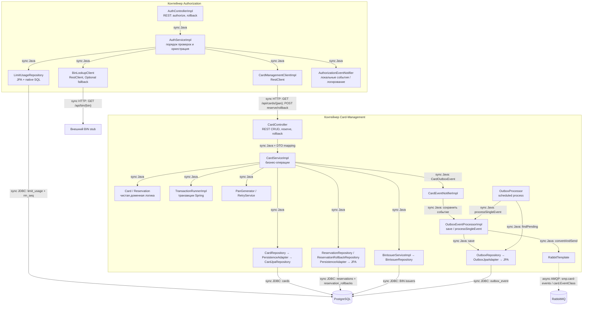

# А3. C4 Component — Authorization и Card-Management

**Чего не хватало:** внутренних компонентов и границ тестовых двойников.
**Что добавлено:** контроллеры, бизнес-логика, HTTP-клиенты, persistence-адаптеры, транзакционные границы и outbox scheduler.

## Верификация и границы

| Компонент | Код и значение для тестирования |
|---|---|
| HTTP-контракт Authorization | [AuthControllerImpl.java](../../../services/authorization/src/main/java/com/processing/authorization/controller/AuthControllerImpl.java): @Valid, преобразование declineReason в HTTP status; api-тест с mock AuthServiceImpl |
| Бизнес-решение Authorization | [AuthServiceImpl.java](../../../services/authorization/src/main/java/com/processing/authorization/services/AuthServiceImpl.java): сначала CMS, затем BIN, статус, срок, баланс, SQL лимитов, reserve; unit изолирует клиентов и repository |
| HTTP-клиенты | [CardManagementClientImpl.java](../../../services/authorization/src/main/java/com/processing/authorization/client/CardManagementClientImpl.java), [BinLookupClient.java](../../../services/authorization/src/main/java/com/processing/authorization/client/BinLookupClient.java): для контрактов — локальный HTTP stub; для unit сервиса — mock интерфейса/клиента |
| Лимиты и RRN | [LimitUsageRepository.java](../../../services/authorization/src/main/java/com/processing/authorization/repositories/LimitUsageRepository.java): PostgreSQL upsert и sequence; корректность SQL требует integration, mock возвращающий 0/1 её не проверяет |
| CRUD и резерв | [CardController.java](../../../services/card-management/src/main/java/com/processing/cardmanagement/controllers/CardController.java), [CardServiceImpl.java](../../../services/card-management/src/main/java/com/processing/cardmanagement/services/CardServiceImpl.java), [Card.java](../../../services/card-management/src/main/java/com/processing/cardmanagement/models/Card.java), [Reservation.java](../../../services/card-management/src/main/java/com/processing/cardmanagement/models/Reservation.java) |
| Транзакции и блокировки CMS | [TransactionRunnerImpl.java](../../../services/card-management/src/main/java/com/processing/cardmanagement/services/TransactionRunnerImpl.java), [CardJpaRepository.java](../../../services/card-management/src/main/java/com/processing/cardmanagement/repositories/CardJpaRepository.java): PESSIMISTIC_WRITE; [CardRepositoryPersistenceAdapter.java](../../../services/card-management/src/main/java/com/processing/cardmanagement/repositories/CardRepositoryPersistenceAdapter.java): JPA adapter. Для блокировок нужна реальная БД |
| Формирование outbox | [CardEventNotifierImpl.java](../../../services/card-management/src/main/java/com/processing/cardmanagement/events/CardEventNotifierImpl.java): CardOutboxEvent сохраняется через processor; остальные события направляются локальным listeners |
| Фоновая отправка | [OutboxProcessor.java](../../../services/card-management/src/main/java/com/processing/cardmanagement/services/OutboxProcessor.java): fixedDelay по конфигурации, выбор PENDING; [OutboxEventProcessorImpl.java](../../../services/card-management/src/main/java/com/processing/cardmanagement/services/OutboxEventProcessorImpl.java): convertAndSend и PROCESSED / retry / FAILED |
| Хранение и AMQP | [OutboxJpaAdapter.java](../../../services/card-management/src/main/java/com/processing/cardmanagement/repositories/OutboxJpaAdapter.java), [CardOutboxEventData.java](../../../services/card-management/src/main/java/com/processing/cardmanagement/models/CardOutboxEventData.java), [RabbitMQConfig.java](../../../services/card-management/src/main/java/com/processing/cardmanagement/config/RabbitMQConfig.java), [application.properties](../../../services/card-management/src/main/resources/application.properties) |

**Тонкости атомарности:** patch/delete/reserve/rollback обёрнуты в TransactionRunner, включая вызов notifier. У createCard нет такой внешней обёртки: сначала repository.create(), потом событие; нельзя обещать общую атомарность создания карты и outbox для всех операций ([CardServiceImpl.java](../../../services/card-management/src/main/java/com/processing/cardmanagement/services/CardServiceImpl.java)). У bulkUpdateStatus есть обновление карт, но нет вызова notifier — наличие класса события ещё не доказывает его публикацию.

В Authorization @Transactional относится к локальной БД. Он не делает HTTP reserve частью распределённой транзакции. Лимиты обновляются **до** reserve; перехваченная ошибка reserve возвращает DECLINED, а не пробрасывается наружу. Автоматическое восстановление лимитов таким кодом не доказано. rollback() вызывает CMS, но не уменьшает limit_usage ([AuthServiceImpl.java](../../../services/authorization/src/main/java/com/processing/authorization/services/AuthServiceImpl.java)). Эти места — предмет интеграционных проверок, не гарантия диаграммы.
