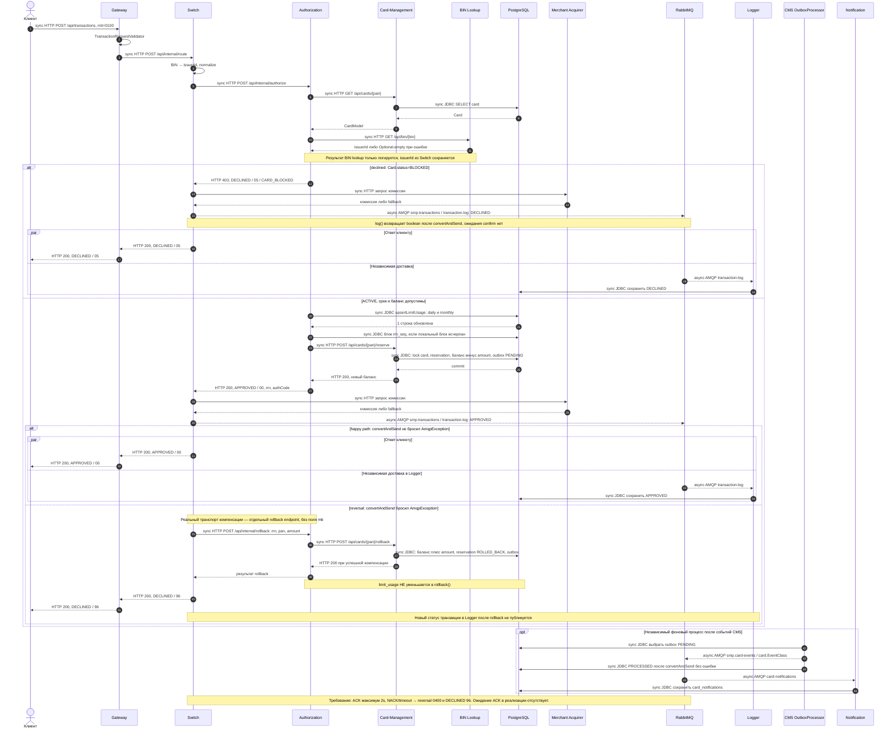

# А4. Sequence — happy path, declined, reversal

**Чего не хватало:** declined и компенсации при сбое публикации, разграничения ответа клиенту и обработки очереди.
**Что добавлено:** три ветки фактического исполнения и явно отделённое требование MTI 0400 / confirm 2s.

Легенда sequence: ->> — синхронный вызов; -->> с подписью HTTP/данные — возврат; -->> с подписью AMQP — асинхронное сообщение. Тип связи определяется подписью, поскольку пунктир используется также для возвратов. Ветки par показывают отсутствие гарантированного порядка: Logger может записать результат как до ответа клиенту, так и после него.

## Проверка сценариев и расхождений

| Участок | Код / вывод |
|---|---|
| Вход и маршрутизация | [TransactionRequestValidator.java](../../../services/gateway/src/main/java/com/processing/gateway/validation/TransactionRequestValidator.java), [application.yml](../../../services/gateway/src/main/resources/application.yml), [RoutingService.java](../../../services/switch/src/main/java/com/processing/service/RoutingService.java), [RouteService.java](../../../services/switch/src/main/java/com/processing/service/RouteService.java) |
| Порядок CMS → BIN → статус → срок → баланс → лимиты → reserve | [AuthServiceImpl.java](../../../services/authorization/src/main/java/com/processing/authorization/services/AuthServiceImpl.java); SQL лимитов — [LimitUsageRepository.java](../../../services/authorization/src/main/java/com/processing/authorization/repositories/LimitUsageRepository.java) |
| BLOCKED | [DeclineOutcome.java](../../../services/authorization/src/main/java/com/processing/authorization/constants/DeclineOutcome.java): CARD_BLOCKED / 05; [AuthControllerImpl.java](../../../services/authorization/src/main/java/com/processing/authorization/controller/AuthControllerImpl.java): HTTP 403; [AuthorizationClient.java](../../../services/switch/src/main/java/com/processing/service/AuthorizationClient.java) принимает тело non-2xx как бизнес-ответ |
| Внешний HTTP 200 | [RouteController](../../../services/switch/src/main/java/com/processing/controller/RouteController.java) возвращает ResponseEntity.ok даже для DECLINED |
| Комиссия после Authorization | [RouteService.java](../../../services/switch/src/main/java/com/processing/service/RouteService.java), [MerchantAcquirerClient.java](../../../services/switch/src/main/java/com/processing/service/MerchantAcquirerClient.java); выполняется и для нормального бизнес-отказа |
| Публикация и rollback | [LoggerClient.java](../../../services/switch/src/main/java/com/processing/service/LoggerClient.java) ловит AmqpException; [RouteService.java](../../../services/switch/src/main/java/com/processing/service/RouteService.java) вызывает rollback только после APPROVED и log=false |
| Payload компенсации | [AuthorizationClient.java](../../../services/switch/src/main/java/com/processing/service/AuthorizationClient.java) создаёт [RollbackRequest.java](../../../services/common/src/main/java/com/processing/common/dto/authorization/RollbackRequest.java) с rrn/pan/amount; MTI в этом DTO отсутствует |
| Резерв/компенсация/outbox | [CardServiceImpl.java](../../../services/card-management/src/main/java/com/processing/cardmanagement/services/CardServiceImpl.java), [Reservation.java](../../../services/card-management/src/main/java/com/processing/cardmanagement/models/Reservation.java), [CardEventNotifierImpl.java](../../../services/card-management/src/main/java/com/processing/cardmanagement/events/CardEventNotifierImpl.java), [OutboxProcessor.java](../../../services/card-management/src/main/java/com/processing/cardmanagement/services/OutboxProcessor.java), [OutboxEventProcessorImpl.java](../../../services/card-management/src/main/java/com/processing/cardmanagement/services/OutboxEventProcessorImpl.java) |
| Сохранение потребителями | [TransactionLogListener.java](../../../services/transaction-logger/src/main/java/com/processing/transactionlogger/listener/TransactionLogListener.java), [TransactionService.java](../../../services/transaction-logger/src/main/java/com/processing/transactionlogger/service/TransactionService.java), [CardEventListener.java](../../../services/notification-service/src/main/java/com/processing/notification/listener/CardEventListener.java) |

**Что означает «reversal (0400)» в задании:** [03-switch.md](../../../tz/03-switch.md) требует MTI 0400 и ожидание confirm 2s; [AuthorizationRequest.java](../../../services/common/src/main/java/com/processing/common/dto/authorization/AuthorizationRequest.java) содержит forReversal(), но фактический [AuthorizationClient.java](../../../services/switch/src/main/java/com/processing/service/AuthorizationClient.java) этот метод не вызывает. Внешний Gateway принимает только 0100 ([TransactionRequestValidator.java](../../../services/gateway/src/main/java/com/processing/gateway/validation/TransactionRequestValidator.java)). Таким образом, на схеме 0400 обозначен как требуемая семантика, а действующий rollback endpoint показан буквально по коду. Нельзя рисовать уже реализованную передачу 0400.

**Ограничения:** correlated в конфигурации не означает ожидание ACK в log(). При сбое самой компенсации Switch всё равно возвращает 96: успешное восстановление баланса не гарантировано ([RouteService.java](../../../services/switch/src/main/java/com/processing/service/RouteService.java)). Отсутствие confirm также не доказывает отсутствие принятого сообщения — запись APPROVED в Logger и отказ клиенту могут разойтись. Поведение под сетевыми отказами требует запуска тестов; схема основана на статическом чтении.
