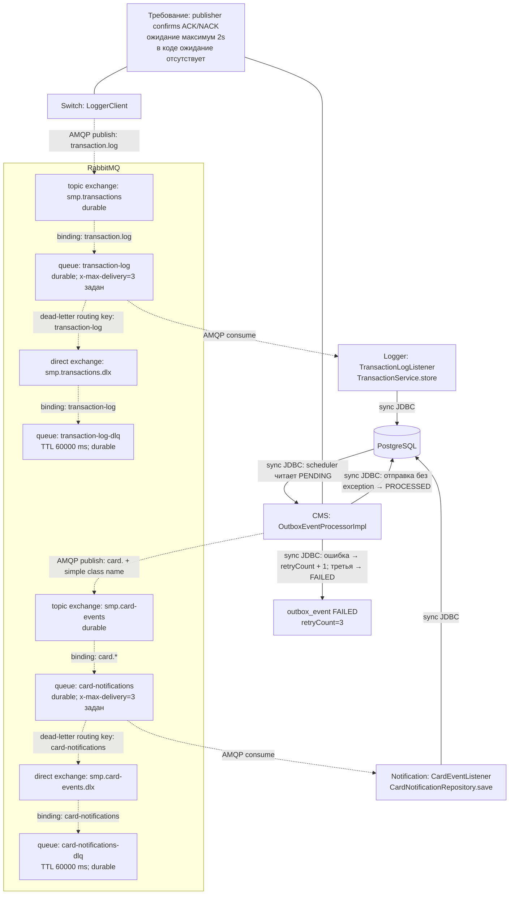

# А5. RabbitMQ — топология и механизмы надёжности

**Чего не хватало:** визуальных цепочек exchange → queue → consumer, DLX/DLQ и отделения настроек от реально реализованной обработки подтверждений.
**Что добавлено:** две AMQP-топологии, точные routing keys, TTL DLQ, outbox retry и выявленные пробелы confirm/retry consumers.

Все пунктирные связи — async AMQP. Сплошные — JDBC или пояснение (ACK). Binding — правило маршрутизации внутри брокера, а не отдельный HTTP-вызов.

## Топология, подтверждённая кодом

| Что | Подтверждение |
|---|---|
| smp.transactions → transaction-log; DLX → DLQ | [RabbitMQConfig.java](../../../services/switch/src/main/java/com/processing/config/RabbitMQConfig.java); основной exchange/queue также объявляет [Logger RabbitMQConfig](../../../services/transaction-logger/src/main/java/com/processing/transactionlogger/config/RabbitMQConfig.java) |
| smp.card-events → card-notifications; DLX → DLQ | [RabbitMQConfig.java](../../../services/card-management/src/main/java/com/processing/cardmanagement/config/RabbitMQConfig.java), [RabbitMQConfig.java](../../../services/notification-service/src/main/java/com/processing/notification/config/RabbitMQConfig.java) |
| Производители и точные ключи | [LoggerClient.java](../../../services/switch/src/main/java/com/processing/service/LoggerClient.java); [OutboxEventProcessorImpl.java](../../../services/card-management/src/main/java/com/processing/cardmanagement/services/OutboxEventProcessorImpl.java): card. + event.getClass().getSimpleName() |
| Consumers | [TransactionLogListener.java](../../../services/transaction-logger/src/main/java/com/processing/transactionlogger/listener/TransactionLogListener.java), [CardEventListener.java](../../../services/notification-service/src/main/java/com/processing/notification/listener/CardEventListener.java) |
| correlated и publisher-returns | [application.yml](../../../services/switch/src/main/resources/application.yml), [application.properties](../../../services/card-management/src/main/resources/application.properties) |
| PENDING / PROCESSED / FAILED | [CardOutboxEventData.java](../../../services/card-management/src/main/java/com/processing/cardmanagement/models/CardOutboxEventData.java), [OutboxEventProcessorImpl.java](../../../services/card-management/src/main/java/com/processing/cardmanagement/services/OutboxEventProcessorImpl.java), [OutboxProcessor.java](../../../services/card-management/src/main/java/com/processing/cardmanagement/services/OutboxProcessor.java), [OutboxJpaAdapter.java](../../../services/card-management/src/main/java/com/processing/cardmanagement/repositories/OutboxJpaAdapter.java) |
| Требуемые confirm 2s и reversal | [03-switch.md](../../../tz/03-switch.md), [architecture.md](../../../docs/architecture.md) |

## Не смешивать три разных механизма

1. **Publisher confirm** — подтверждение брокера отправителю, а не подтверждение записи в БД Logger. Correlated включён, но producers вызывают только convertAndSend: нет CorrelationData future, ожидания 2s или обработки результата confirm. В Switch rollback запускается при AmqpException. Требование ACK/NACK + timeout остаётся непокрытым реализацией.
2. **Outbox retry** — в [OutboxEventProcessorImpl.java](../../../services/card-management/src/main/java/com/processing/cardmanagement/services/OutboxEventProcessorImpl.java) при исключении увеличивается retryCount; после третьей ошибки статус FAILED. [OutboxProcessor.java](../../../services/card-management/src/main/java/com/processing/cardmanagement/services/OutboxProcessor.java) запускается с fixedDelay, default 1000 ms ([application.properties](../../../services/card-management/src/main/resources/application.properties)). Exponential backoff из документации отсутствует. FAILED остаётся в PostgreSQL, это **не DLQ**; автоматического возврата FAILED в PENDING здесь нет.
3. **Consumer retry** — в декларации очередей указан x-max-delivery=3, но в [application.yaml](../../../services/transaction-logger/src/main/resources/application.yaml) и [application.yml](../../../services/notification-service/src/main/resources/application.yml) не задан listener retry с тремя попытками и recovery policy. Один аргумент очереди не является доказательством настроенной Spring retry-цепочки. Переход в DLQ после ровно трёх неуспешных обработок необходимо проверять отдельным интеграционным сценарием; не считать его уже гарантированным.

**TTL 60s относится к сообщениям в DLQ**, а не к задержке перед повтором основной очереди. Обратного binding DLQ → основная очередь в конфигурации нет. Диагностику DLQ нужно проводить до истечения TTL. Наличие маршрута в DLX не означает, что всякая ошибка listener автоматически приводит туда.

