# А6. State-transition — Card и жизненный цикл операции

**Чего не хватало:** диаграмм состояний и связи статусов с операциями.
**Что добавлено:** статусы карты, фактические переходы PATCH/DELETE и разделение TransactionStatus от ReservationStatus.

```mermaid
stateDiagram-v2
    state "Card.status (хранится в cards)" as CARD {
        [*] --> ACTIVE: createCard
        ACTIVE --> INACTIVE: PATCH status
        INACTIVE --> ACTIVE: PATCH status
        ACTIVE --> BLOCKED: PATCH status
        BLOCKED --> ACTIVE: PATCH status
        ACTIVE --> EXPIRED: PATCH status
        EXPIRED --> ACTIVE: PATCH status
        INACTIVE --> BLOCKED: PATCH status
        BLOCKED --> INACTIVE: PATCH status
        INACTIVE --> EXPIRED: PATCH status
        EXPIRED --> INACTIVE: PATCH status
        BLOCKED --> EXPIRED: PATCH status
        EXPIRED --> BLOCKED: PATCH status
        ACTIVE --> DELETED: DELETE или PATCH status
        INACTIVE --> DELETED: DELETE или PATCH status
        BLOCKED --> DELETED: DELETE или PATCH status
        EXPIRED --> DELETED: DELETE или PATCH status
        DELETED --> [*]: скрыта SQLRestriction; штатный GET возвращает 404
    }
    state "Операция: бизнес-результат и резерв — разные модели" as TX {
        [*] --> RECEIVED
        RECEIVED --> DECLINED: отказ проверок; резерва нет
        RECEIVED --> APPROVED: проверки прошли, резерв создан
        APPROVED --> LOGGED: успешная доставка и store в Logger
        APPROVED --> COMPENSATING: log=false; требование reversal 0400
        COMPENSATING --> ROLLED_BACK: CMS rollback успешен
        COMPENSATING --> RESERVED_ERROR: rollback не выполнен
        ROLLED_BACK --> CLIENT_96: клиенту DECLINED 96
        RESERVED_ERROR --> CLIENT_96: клиенту также DECLINED 96
        DECLINED --> [*]
        LOGGED --> [*]
        CLIENT_96 --> [*]
    }
    note right of EXPIRED
        Истечение expiryDate само не меняет Card.status.
        authorize возвращает DECLINED 54.
    end note
    note right of ROLLED_BACK
        Это Reservation.status.
        TransactionStatus содержит только APPROVED и DECLINED.
        Обновление Logger после rollback не реализовано.
    end note
```

## Что является состоянием модели

| Объект | Состояния и переходы | Код |
|---|---|---|
| Card | ACTIVE, INACTIVE, BLOCKED, EXPIRED, DELETED | [CardStatus.java](../../../services/card-management/src/main/java/com/processing/cardmanagement/models/CardStatus.java) |
| Создание | Обычное createCard задаёт ACTIVE; пакетное createCards использует status из CardDraft | [CardServiceImpl.java](../../../services/card-management/src/main/java/com/processing/cardmanagement/services/CardServiceImpl.java), [Card.java](../../../services/card-management/src/main/java/com/processing/cardmanagement/models/Card.java) |
| PATCH / bulk update | withData не задаёт таблицу допустимых переходов: доступны переходы между четырьмя неудалёнными статусами; можно также поставить DELETED | [CardServiceImpl.java](../../../services/card-management/src/main/java/com/processing/cardmanagement/services/CardServiceImpl.java), [Card.java](../../../services/card-management/src/main/java/com/processing/cardmanagement/models/Card.java), [CardController.java](../../../services/card-management/src/main/java/com/processing/cardmanagement/controllers/CardController.java) |
| DELETE | deleted() устанавливает DELETED; последующее штатное чтение скрывает карту | [Card.java](../../../services/card-management/src/main/java/com/processing/cardmanagement/models/Card.java), [CardEntity.java](../../../services/card-management/src/main/java/com/processing/cardmanagement/models/CardEntity.java): SQLRestriction |
| Срок действия | expiryDate.atEndOfMonth() сравнивается с transmissionDateTime в UTC; возвращается CARD_EXPIRED / 54 без изменения Card.status | [AuthServiceImpl.java](../../../services/authorization/src/main/java/com/processing/authorization/services/AuthServiceImpl.java), [DeclineOutcome.java](../../../services/authorization/src/main/java/com/processing/authorization/constants/DeclineOutcome.java) |
| Transaction в Logger | Только APPROVED / DECLINED; store сохраняет исходный результат, не выполняет переход APPROVED → ROLLED_BACK | [TransactionStatus.java](../../../services/common/src/main/java/com/processing/common/dto/transactionlogger/TransactionStatus.java), [TransactionService.java](../../../services/transaction-logger/src/main/java/com/processing/transactionlogger/service/TransactionService.java), [RouteService.java](../../../services/switch/src/main/java/com/processing/service/RouteService.java) |
| Reservation в CMS | RESERVED → ROLLED_BACK; повторный rollback бросает RollbackAlreadySatisfiedException | [Reservation.java](../../../services/card-management/src/main/java/com/processing/cardmanagement/models/Reservation.java), [CardServiceImpl.java](../../../services/card-management/src/main/java/com/processing/cardmanagement/services/CardServiceImpl.java) |
| Компенсация | Ошибка публикации после APPROVED → попытка rollback → клиенту DECLINED 96; успех rollback не проверяется как условие ответа 96 | [RouteService.java](../../../services/switch/src/main/java/com/processing/service/RouteService.java), [AuthorizationClient.java](../../../services/switch/src/main/java/com/processing/service/AuthorizationClient.java) |
| Требуемый reversal | MTI 0400 — требование; реально используется RollbackRequest без MTI | [03-switch.md](../../../tz/03-switch.md), [RollbackRequest.java](../../../services/common/src/main/java/com/processing/common/dto/authorization/RollbackRequest.java), [AuthorizationRequest.java](../../../services/common/src/main/java/com/processing/common/dto/authorization/AuthorizationRequest.java) |

RECEIVED, LOGGED, COMPENSATING, RESERVED_ERROR, CLIENT_96 — **аналитические этапы сценария**, не enum и не значения поля БД. APPROVED/DECLINED обозначают решение авторизации; ROLLED_BACK — состояние резерва. Таким образом, требования жизненного цикла отражены без выдуманного третьего статуса Transaction.

После DELETED обратный переход через обычный PATCH невозможен: getCardForUpdate не найдёт запись из-за SQLRestriction. Финальный узел означает конец доступного через API жизненного цикла, а не физическое удаление строки.

**Ограничение компенсации:** возврат баланса не означает восстановления всей системы. [AuthServiceImpl.java](../../../services/authorization/src/main/java/com/processing/authorization/services/AuthServiceImpl.java).rollback() не уменьшает limit_usage, [RouteService.java](../../../services/switch/src/main/java/com/processing/service/RouteService.java) не отправляет в Logger событие смены статуса. Эти расхождения вынесены в тест-кейсы.
